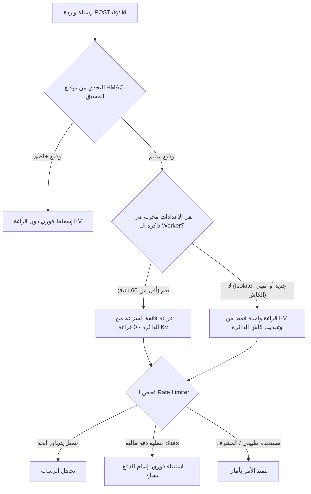

# دليل الأمان الشامل للبوتات والذكاء الاصطناعي (OWASP GenAI & Cloud Architecture)

يوثق هذا المستند المعايير الأمنية والهندسية المتطورة المطبقة في منصة **ZeidexSoft** لحماية البوتات، وتطبيقات النماذج اللغوية (LLM Agents)، والبنية السحابية في Cloudflare Workers وفقاً لأحدث معايير عام 2026.

---

## 1. المراجع وقواعد البيانات العالمية المعتمدة

| المرجع / المنظمة | الرابط الرسمي | الغرض الأساسي | نوع التهديدات المغطاة |
|---|---|---|---|
| **OWASP Top 10 for LLM Applications (2026)** | [genai.owasp.org](https://genai.owasp.org/) | مراجعة الكود، التقييم الذاتي، وتطبيق أفضل معايير الحماية المعمارية للبوت | ثغرات منطق التصميم، حقن الأوامر (Prompt Injection)، تسريب البيانات الحساسة، الوكالة المفرطة |
| **NIST AI Risk Management Framework (AI RMF)** | [nist.gov/itl/ai-risk-management](https://www.nist.gov/itl/ai-risk-management-framework) | حوكمة مخاطر الذكاء الاصطناعي وقياس مدى موثوقية وأمان النماذج | المخاطر المؤسسية، التحيز، الأمان التشغيلي، الموثوقية |
| **CISA Guidelines for Secure AI System Development** | [cisa.gov/ai](https://www.cisa.gov/ai) | إرشادات الوكالات الدولية لتطوير وتصميم وتشغيل أنظمة الذكاء الاصطناعي بأمان | الأمان بالتصميم (Secure by Design)، سلاسل التوريد، عمليات النشر |
| **MITRE ATLAS** | [ai-risk.mitre.org](https://ai-risk.mitre.org/) | فهم تفكير المهاجمين واختبار اختراق البوتات وأنظمة الذكاء الاصطناعي (Red Teaming) | الهجمات المتقدمة، اختراق النماذج، تسميم البيانات، الهروب من القيود |
| **AVID (AI Vulnerability Database)** | [avidml.org](https://avidml.org/) | تتبع سجلات الفشل الواقعية، العيوب الأمنية، والأخطاء البرمجية المكتشفة | عيوب الأداء، الثغرات المكتشفة في النماذج، حوادث الذكاء الاصطناعي الحقيقية |

---

## 2. المبادئ المعمارية الجوهرية (Language-Agnostic Design Principles)

### 2.1 نمط البوابة الصارمة (The "Strict Gateway" Pattern & Zero-Trust)
- **المشكلة الشائعة (Excessive Agency)**: منح البوت أو الوكيل أداة تنفيذية (مثل تنفيذ كود، تعديل بيانات، مسح سجلات) والاعتماد على توجيهات النظام (System Prompt) للتحقق مما إذا كان المستخدم يملك الصلاحية.
- **الحل الهندسي المعتمد في المشروع**: معاملة البوت كأنه مستخدم واجهة غير موثوق به (Untrusted Frontend). كافة الصلاحيات، عمليات التحقق، والوظائف الحساسة (`/admin`, `/licnew`, `/lRevoke`, إلخ) يتم فحصها حتمياً في كود الخلفية الثابت (`uid === cfg.owner` أو `safeEqual(token, ADMIN_TOKEN)`) قبل الوصول إلى أي بيانات حساسة في Cloudflare KV.

### 2.2 الفصل الصارم للسياق (Context Separation & Prompt Injection Defense)
- **المشكلة الشائعة**: دمج مدخلات المستخدم مباشرة مع تعليمات النظام البرمجية.
- **الحل الهندسي**: فصل توجيهات النظام في أدوار بنيوية صارمة (Developer/System Role مقابل User Role)، واستخدام حواجز مشفرة أو محددات بنيوية (مثل وسوم XML أو معاملات مهيأة مسبقاً) لمنع كسر السياق.

### 2.3 تطهير المدخلات والمخرجات (Sanitization & XSS Prevention)
- **المشكلة الشائعة (Improper Output Handling)**: تمرير ردود البوت مباشرة إلى المتصفح أو تطبيق تيليجرام دون تنظيف.
- **الحل الهندسي**: افتراض أن مخرجات الذكاء الاصطناعي ملوثة. في تيليجرام يتم تطهير كافة النصوص باستخدام دالة `esc()` (`replace(/[&<>"]/g, ...)`). وفي متصفح الويب والـ Mini Apps يُمنع استخدام `innerHTML` أو `dangerouslySetInnerHTML`.

---

## 3. أدوات التطوير والفحص الموصى بها (Developer Tooling & Red-Teaming)

### 3.1 جدران الحماية والقيود أثناء التشغيل (Runtime Guardrails)
- **NeMo Guardrails (NVIDIA)**: وضع مسارات برمجية تمنع النموذج من الخوض في مواضيع خارج النطاق أو تنفيذ تعليمات ضارة.
- **LLM Guard (Protect AI)**: فحص مباشر لمدخلات المستخدم لاكتشاف محاولات كسر الحماية (Jailbreaks) وتسريب البيانات، وتدقيق المخرجات للتأكد من خلوها من الأكواد الخبيثة.

### 3.2 أدوات اختبار الاختراق ومحاكاة الهجمات (Automated Red-Teaming)
- **Garak**: ماسح ثغرات الذكاء الاصطناعي (مثل Nmap للنماذج)، يقوم بفحص نقاط النهاية لاكتشاف ثغرات الـ Injection وتسريب البيانات.
- **Promptfoo**: أداة سطر أوامر تفاعلية لتشغيل اختبارات أمان مؤتمتة وتقييم جودة الردود وصمود القيود أمام المدخلات العدائية.

### 3.3 الفحص الساكن للكود وحزم التبعيات (Static Analysis & SCA)
- **Snyk / GitHub Advanced Security**: اكتشاف التبعيات البرمجية المعطوبة أو المفاتيح المسربة في المستودع.
- **Semgrep**: فحص قواعد الكود والتهيئة الأمنية لمنع الأخطاء الشائعة قبل وصولها إلى الإنتاج.

---

## 4. تدفق حماية الحصة السحابية (Cloudflare Workers KV Flood Defense)

---

## 5. نظام أتمتة التراخيص عبر متجر الويب (Automated Web Storefront Licensing)

- عند تأكيد عملية الدفع الإلكتروني (عبر بنك الكريمي E-Pay أو بوابات الدفع الرسمية)، يقوم السيرفر السحابي باستدعاء التابع `issueLicense()` تلقائياً.
- يتم إنشاء مفتاح ترخيص رقمي وفق معيار Crockford Base32 مع كود تحقق مشفر (20 محرفاً + 2 فحص تحقق).
- يظهر المفتاح للمشتري فوراً على شاشة المتجر مع نسخه تلقائياً، ويتم حفظ الـ Hash المشفر فقط (`kh`) في Cloudflare KV.
- يرتبط الترخيص بالعتاد الفعلي لجهاز المشتري عبر Android Keystore و Hardware-Backed ECDSA P-256 لمنع تزوير أو مشاركة التراخيص.
